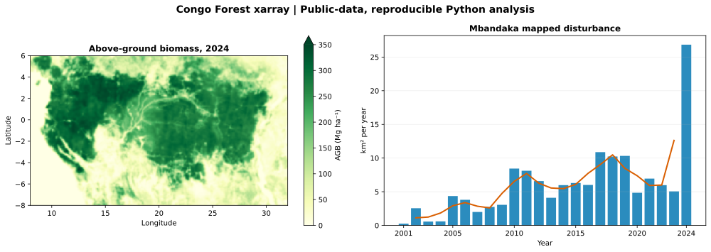
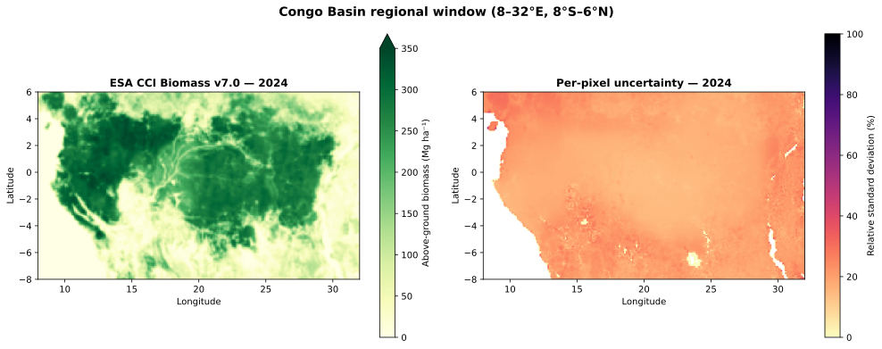
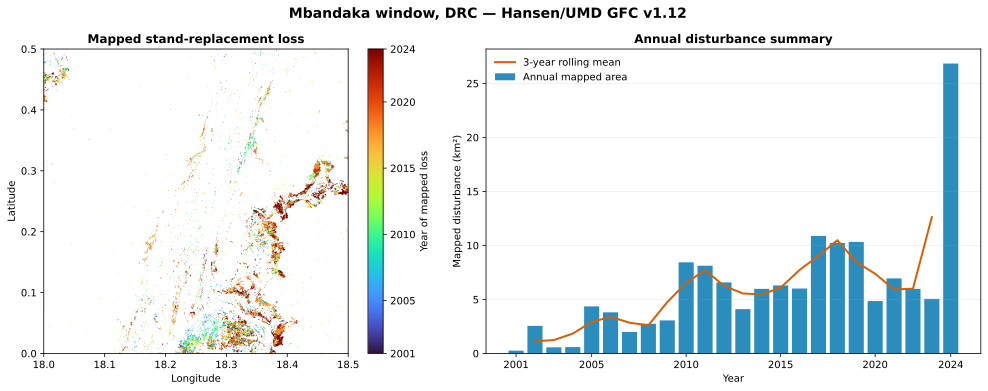

# Congo Forest xarray

[](https://github.com/kisife/congo-forest-xarray/actions/workflows/ci.yml)
[](https://www.python.org/)
[](LICENSE)

**Reproducible forest biomass and disturbance analysis with public Earth-observation data, Python, and xarray.**

This portfolio project combines two complementary analyses:

1. **Regional above-ground biomass and uncertainty** in a Congo Basin window using ESA CCI Biomass v7.0 at 10 km resolution.
2. **Mapped stand-replacement disturbance** in a 0.5° × 0.5° window near Mbandaka, Democratic Republic of the Congo, using Hansen/UMD Global Forest Change v1.12 at 30 m resolution.

The workflow uses public, credential-free data services; xarray-labelled arrays; latitude-aware pixel areas; reproducible notebooks; tested source functions; and version-controlled figures and tables.



## Results at a glance

### ESA CCI Biomass regional window

| 2024 descriptive indicator | Result |
|---|---:|
| Area-weighted mean above-ground biomass | **146.14 Mg ha⁻¹** |
| Total mapped woody AGB stock in the rectangular window | **60.55 Pg** |
| Area with AGB ≥ 200 Mg ha⁻¹ | **39.00%** |
| Median relative per-pixel uncertainty | **18.18%** |

These values describe the 8–32°E, 8°S–6°N analysis window. The stock includes all mapped woody biomass, is not forest-only, and is not converted to carbon or CO₂.

### Mbandaka disturbance window

| 2001–2024 descriptive indicator | Result |
|---|---:|
| Cumulative mapped stand-replacement disturbance | **146.56 km²** |
| Largest annual mapped value | **26.84 km² in 2024** |
| Spatial resolution | **30 m** |
| Temporal coverage | **2001–2024** |

The annual values are pixel-based map summaries, not design-based area estimates with confidence intervals. The 2024 value is reported descriptively and should not be interpreted as a causal trend or a sudden real-world change without further validation.

## Reviewer guide

- **[Biomass notebook](notebooks/01_biomass_congo.ipynb):** remote subsetting, xarray data model, area weighting, uncertainty, and maps.
- **[Disturbance notebook](notebooks/02_disturbance_mbandaka.ipynb):** aligned raster windows, annual area accounting, and visualisation.
- **[Reusable source code](src/congo_forest/):** data access, spatial calculations, and summaries.
- **[Figures](outputs/figures/) and [tables](outputs/tables/):** small, version-controlled outputs for rapid review.
- **[Unit tests](tests/test_analysis.py):** offline tests of pixel area, masking, annual accounting, and biomass summaries.

## Quick start

Requires Python 3.11+ (tested with Python 3.12).

```bash
git clone https://github.com/kisife/congo-forest-xarray.git
cd congo-forest-xarray
python -m venv .venv
source .venv/bin/activate       # Windows: .venv\Scripts\activate
pip install -r requirements.txt
python scripts/reproduce.py
```

The script downloads only the required regional subsets, caches them locally, and recreates all outputs. Large source rasters and caches are excluded from version control.

To run the notebooks:

```bash
jupyter notebook notebooks/
```

To run the offline tests:

```bash
python -m unittest discover -s tests -v
```

## Repository structure

```text
congo-forest-xarray/
├── notebooks/
│   ├── 01_biomass_congo.ipynb
│   └── 02_disturbance_mbandaka.ipynb
├── src/congo_forest/
│   ├── biomass.py          # ESA access and biomass summaries
│   ├── disturbance.py      # GFC access and annual summaries
│   ├── spatial.py          # Latitude-aware pixel areas
│   └── config.py           # Pinned versions, bounds, and paths
├── scripts/reproduce.py    # End-to-end reproduction
├── tests/                  # Offline unit tests
├── outputs/                # SVG figures, CSV tables, JSON summary
├── data/README.md          # Data access, terms, and cache policy
└── .github/workflows/ci.yml
```

## Methods

### 1. Above-ground biomass

- Reads `agb` and `agb_sd` from the official CEDA NetCDF Subset Service.
- Uses the 10 km ESA CCI Biomass v7.0 product with 18 annual layers: 2005–2012 and 2015–2024.
- Selects the regional window with labelled xarray coordinates.
- Computes spherical pixel areas from latitude cell edges.
- Reports area-weighted mean density, regional stock, high-biomass area share, and relative standard deviation.



### 2. Forest disturbance

- Reads aligned `lossyear` and `datamask` windows from public Hansen/UMD GeoTIFF tiles with rasterio.
- Constructs an xarray Dataset with explicit coordinates and metadata.
- Excludes water and no-data pixels.
- Converts loss-year classes to annual mapped area using spherical pixel areas.
- Adds a centred three-year rolling mean as a visual smoother.



## Important limitations

- The biomass study frame is rectangular, not an exact Congo Basin watershed boundary.
- ESA AGB is not masked to a forest definition; regional stock includes mapped woody biomass outside forests.
- Biomass differences between years are not automatically deforestation, degradation, growth, emissions, or removals.
- The disturbance window is a local case study, not a national or basin-wide estimate.
- No year-2000 tree-cover baseline is applied, so disturbance is not reported as a percentage of forest area or as net forest change.
- Hansen loss represents first mapped stand-replacement disturbance; it does not capture all degradation, selective logging, regeneration, or gain, and it does not assign a cause.
- Landsat sensor and algorithm changes affect temporal consistency. Definitive area estimation requires an appropriate statistical design and uncertainty analysis.

## Public data and citations

**ESA CCI Biomass v7.0**  
Santoro, M.; Cartus, O. (2026): *ESA Biomass Climate Change Initiative (Biomass_cci): Global datasets of forest above-ground biomass for the years 2005–2012 and 2015–2024, v7.0.* NERC EDS Centre for Environmental Data Analysis, 21 May 2026. [doi:10.5285/6429d1aafe1e43b9b414e4a5a7f8b903](https://doi.org/10.5285/6429d1aafe1e43b9b414e4a5a7f8b903).

**Hansen/UMD Global Forest Change v1.12**  
Hansen, M. C. et al. (2013): *High-Resolution Global Maps of 21st-Century Forest Cover Change.* Science 342: 850–853. Data: [Global Forest Change 2000–2024](https://storage.googleapis.com/earthenginepartners-hansen/GFC-2024-v1.12/download.html). Display credit: **Hansen/UMD/Google/USGS/NASA**. License: CC BY 4.0.

See [data/README.md](data/README.md) for exact endpoints, subsets, and terms.

## License

Code is released under the [MIT License](LICENSE). The datasets retain their respective licences and attribution requirements.

**Author:** [Kisife F Jude](https://github.com/kisife)
